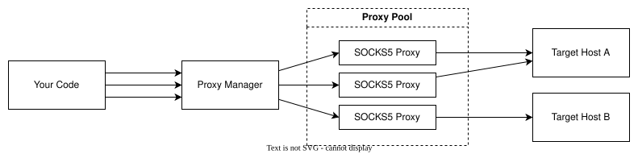

# Forward Proxy Manager

A proxy server that distributes your requests over a pool of proxies. It is made to easily scrape massive amounts of pages on websites behind rate-limiters and other systems without expensive bot protection. Mainly Cloudflare on normal settings. It makes individual requests over random proxies from the pool, so it is best suited for unauthenticated sessions and public pages.

## Features

- Fetches and validates proxy list from a given URL
- Impersonates real Chrome/Firefox: each proxy gets one browser identity whose TLS (JA3/JA4), HTTP/2 settings and header order match its user agent
- Interacts via HTTPS PROXY protocol for seamless integration with various HTTP clients.
- Also has a gRPC interface for more advanced use cases
- Supports HTTPS, HTTP2, persistent connections for high performance
- Keeps track of rate limits on individual proxy-target pairs and backs off on 429 (Too Many Requests) errors
- Retry mechanism for failed requests using alternative proxies
- Replaces client headers with the identity's browser navigation headers; decodes gzip/deflate/br/zstd bodies
- Optional per-proxy cookie session with warm-up page (`x-warmup-url` header)
- Adjustable request priority using `x-priority` header
- Built-in request queue for bulk requests without rate limit concerns
- Optional web dashboard for real-time monitoring of pending requests

## Usage



### 1. Set Up the Proxy Manager

With Docker:

```bash
docker run -it -p 8080:8080 -p 8081:8081 -p 8082:8082 -e PROXY_LIST_URL=https://example.com/proxies ghcr.io/jkelin/forward-proxy-manager:latest
```

Using docker-compose:

```yaml
version: "3.8"
services:
  proxy-manager:
    image: ghcr.io/jkelin/forward-proxy-manager:latest
    ports:
      - 8080:8080
      - 8081:8081
      - 8082:8082
    environment:
      PROXY_LIST_URL: https://example.com/proxies
```

### 2. Integrate with HTTP Client

Proxy Manager is a MITM proxy and uses self-signed certificate. You must configure your HTTP client to ignore certificate errors.

For [Got](https://github.com/sindresorhus/got) in Node.js:

```typescript
import got from "got";
import { HttpsProxyAgent } from "hpagent";

const proxyAgent = new HttpsProxyAgent({
  keepAlive: true,
  proxy: "https://localhost:8080", // https needed to scrape https sites
  rejectUnauthorized: false, // ignore https errors (IMPORTANT)
});

const data = await got({
  method: "GET",
  url: "https://httpbin.org/get", // target url
  headers: {
    "x-priority": "0", // higher priority is going to be processed first
  },
  agent: {
    https: proxyAgent,
  },
}).json();
```

> Note: Since this proxy uses a self-signed certificate, you'll need to configure the HTTP client to ignore certificate validation.

### 3. Cookie sessions (warm-up)

Some sites (e.g. eBay search) reject requests without a session cookie. Each proxy keeps its own cookie jar (one browser on one IP). Send the control header:

| Request header                                        | Meaning                                                                                                                                                                                                                                                                                                                                                    |
| ----------------------------------------------------- | ---------------------------------------------------------------------------------------------------------------------------------------------------------------------------------------------------------------------------------------------------------------------------------------------------------------------------------------------------------- |
| `x-warmup-url: https://www.ebay.com/n/all-categories` | Absolute http(s) URL. If the chosen proxy has no session for the target host, it first GETs this URL as a typed navigation (`Sec-Fetch-Site: none`), storing its cookies. The real request then goes out as a link click: `Referer` and `Sec-Fetch-Site` derived from the warm-up URL (browser rules), plus the stored cookies. Invalid values return 400. |

| Response header   | Values                                                                                                                                            |
| ----------------- | ------------------------------------------------------------------------------------------------------------------------------------------------- |
| `X-Fpm-Warmup`    | `fresh` (warm-up just ran), `reused` (existing session), `failed` (warm-up was not 2xx; its response is returned and the real request is skipped) |
| `X-Fpm-Exit`      | SOCKS endpoint `host:port` from the proxy list that answered (no credentials); absent on proxy error responses                                    |
| `X-Fpm-Challenge` | Only when challenge solving is on and a Cloudflare challenge was involved: `solved`, `reused`, `unchallenged` or `failed` (see below)             |
| `X-Fpm-Pool`      | Only when `FALLBACK_PROXY_LIST_URL` is set: `primary` or `fallback`, the proxy list of the exit that answered (see below)                         |

A 403 from the warm-up or the real request clears that proxy's cookies and retries on another proxy (`RETRIES`). Cookies are stored and sent per proxy for every request; without `x-warmup-url` there is no warm-up, no `Referer` and no retry on 403. Client `Cookie` headers are never forwarded. gRPC uses the `warmup_url` field instead of the header (see [gRPC Proxy](#grpc-proxy)).

### Cloudflare challenges

With `CHALLENGE_SOLVER` set (the Docker image sets it), a Cloudflare challenge (403/503 with `cf-mitigated: challenge`) is handled on the same exit:

1. The request is repeated with the solver's browser identity (iOS Safari TLS/HTTP2 fingerprint and headers from `CHALLENGE_PROFILE`). An answer below 400 is returned as `unchallenged`, or `reused` when an earlier clearance on this exit covered it.
2. Otherwise `fpm-cfsolve` ([cfsolve](https://github.com/chris124567/cfsolve), `solver/`) solves the challenge through the same SOCKS exit and returns the protected page as `solved`. Its cookies (`cf_clearance`) go into the identity's jar.
3. Later requests to that host on that exit use the solver identity and its cookies (`reused`), skipping warm-up. A challenge on them solves again.

A failed solve returns the challenge page with `failed`. Solves run with the caller's deadline instead of `REQUEST_TIMEOUT`, at most `CHALLENGE_CONCURRENCY` at once, one at a time per exit.

### Fallback proxy list

With `FALLBACK_PROXY_LIST_URL` set, a second list (e.g. residential proxies) takes requests that the primary list keeps getting blocked on. A target answer is _blocked_ when its status is in `BLOCK_STATUS_CODES` or the first 128 KiB of its body match `BLOCK_BODY_PATTERN` (default: the titles of eBay's "Pardon Our Interruption", Cloudflare's "Just a moment", Akamai's "Access Denied" and Cloudflare's "Attention Required" pages, plus the logger payload of eBay's splashui interstitial, which is the same in every language). Proxy failures and timeouts are not blocks.

1. A blocked primary attempt retries on another primary exit; it uses `RETRIES`.
2. After `FALLBACK_AFTER_BLOCKS` blocked primary attempts the request moves to the fallback list, if one fallback exit is ready.
3. Blocked fallback attempts retry on fallback exits, without using `RETRIES`, until `FALLBACK_ATTEMPTS` of them were blocked; then the last block is returned.

Only blocked requests reach the fallback list, so its bandwidth tracks the primary list's block rate. Fallback exits get the same warm-up sessions, challenge solving and rate limits.

## Options

Set up the Proxy Manager using environment variables. Only PROXY_LIST_URL is mandatory. For detailed definitions, see [src/main.go](src/main.go). [.env.example](.env.example) lists all variables with defaults.

| Environment                 | Default                                                                                                          | Description                                                                                  |
| --------------------------- | ---------------------------------------------------------------------------------------------------------------- | -------------------------------------------------------------------------------------------- |
| `PROXY_LIST_URL`            | **REQUIRED**                                                                                                     | Absolute http(s) URL from which to download the proxy list. Refer to proxy list format below |
| `IP_CHECK_URL`              | `https://ifconfig.io/ip`                                                                                         | Absolute http(s) URL returning the exit IP; used to check proxy availability                 |
| `REQUEST_TIMEOUT`           | `20s`                                                                                                            | Timeout for individual requests to target host                                               |
| `RETRIES`                   | `1`                                                                                                              | Number of times to retry failed requests to target (`>= 0`)                                  |
| `RETRY_TIMEOUT`             | `5s`                                                                                                             | How long one proxy avoids a host after the host answered 429                                 |
| `INITIAL_IP_INFO_TIMEOUT`   | `10s`                                                                                                            | Timeout for proxy IP info request used to check proxy availability                           |
| `THROTTLE_REQUESTS_PER_MIN` | `30`                                                                                                             | Target host max requests per minute                                                          |
| `THROTTLE_REQUESTS_BURST`   | `5`                                                                                                              | Max concurrent target requests for a single proxy                                            |
| `UNREACHABLE_CLIENT_RETRY`  | `60s`                                                                                                            | Retry for failing proxies                                                                    |
| `ENABLE_WEB`                | `false`                                                                                                          | Enable web UI on `WEB_PORT` for monitoring and debugging pending requests                    |
| `PROXY_PORT`                | `8080`                                                                                                           | HTTP(S) proxy listen port                                                                    |
| `WEB_PORT`                  | `8081`                                                                                                           | Web UI listen port                                                                           |
| `GRPC_PORT`                 | `8082`                                                                                                           | gRPC listen port                                                                             |
| `CHALLENGE_SOLVER`          | empty (image: `/usr/local/bin/fpm-cfsolve`)                                                                      | `fpm-cfsolve` binary name or path; empty disables Cloudflare challenge solving               |
| `CHALLENGE_PROFILE`         | `/profiles/safari-26-ios.json` (the image's copy)                                                                | cfsolve browser profile; its transport profile must have a matching TLS profile              |
| `CHALLENGE_TIMEOUT`         | `120s`                                                                                                           | Limit for one solve                                                                          |
| `CHALLENGE_CONCURRENCY`     | `2`                                                                                                              | Solves running at once across all exits                                                      |
| `FALLBACK_PROXY_LIST_URL`   | empty                                                                                                            | Second proxy list (same format) for blocked requests; empty disables the fallback            |
| `FALLBACK_AFTER_BLOCKS`     | `2`                                                                                                              | Blocked primary attempts that move a request to the fallback list (`1` to `RETRIES + 1`)     |
| `FALLBACK_ATTEMPTS`         | `2`                                                                                                              | Blocked fallback attempts before the block is returned (`>= 1`)                              |
| `BLOCK_STATUS_CODES`        | `403,429`                                                                                                        | Target status codes that count as blocked                                                    |
| `BLOCK_BODY_PATTERN`        | `(?i)<title>(pardon our interruption\|just a moment\|access denied\|attention required)\|serviceName\W+splashui` | Go regexp; a body match counts as blocked; empty disables body matching                      |

Proxy Manager never contacts a target directly: no DNS lookup or reachability probe leaves its own IP. Requests keep their URL scheme; a target that is down shows up as an exit error after retries.

## Proxy list format

`HOST:PORT:USERNAME:PASSWORD`, one per line (LF or CRLF). Malformed lines are skipped.

Proxy list gets downloaded from `PROXY_LIST_URL` on Proxy Manager's startup; a non-2xx response stops startup. Proxies must be SOCKS5, not HTTP. This format is what you get from [Webshare](https://www.webshare.io/?referral_code=x71lsv7e6k56) and similar services.

Example:

```
127.0.0.1:1080:username:password
127.0.0.2:1080:username:password
```

## gRPC Proxy

Forward Proxy Manager also provides a gRPC proxy for more advanced use cases. It is available on `:8082`. Schema definition can be found in [service.proto](service.proto).

`Proxy.SendRequest` semantics:

- `url` must be an absolute http(s) URL, else `ProxyResponseError` `INVALID_URL`.
- `warmup_url` has the same semantics as the HTTP `x-warmup-url` header. An invalid value returns `INVALID_URL`. The success header `x-fpm-warmup` is `fresh`, `reused` or `failed`; it is present only when `warmup_url` is set. On `failed` the response is the warm-up response.
- `retry_on_codes` outside 100-599 returns gRPC status `INVALID_ARGUMENT`.
- A target host that is unreachable through the exits returns `REMOTE_HOST_UNREACHABLE` (HTTP proxy: 502 `Remote host unreachable`).
- Success header names are lower-case (`content-type`, `x-fpm-warmup`, `x-fpm-exit`).
- Client cancellation or deadline removes the request from the queue or aborts it; the RPC ends with gRPC status `CANCELLED` or `DEADLINE_EXCEEDED`.

### Node / Bun client

The [`forward-proxy-manager`](packages/client) npm package wraps the gRPC API (ESM only, Node 22+ or Bun).

```typescript
import { ForwardProxyError, ForwardProxyManager, ProxyErrorType } from "forward-proxy-manager";
import { z } from "zod";

const manager = new ForwardProxyManager("localhost:8082", { semaphore: 100, maxRetries: 2 });

const response = await manager.proxyFetch("https://www.ebay.com/sch/i.html?_nkw=gpu", {
  priority: 1,
  retryOnCodes: [403, 503],
  warmupUrl: "https://www.ebay.com/n/all-categories",
  signal: AbortSignal.timeout(30_000),
});

console.log(response.warmup); // "fresh" | "reused" | "failed" | undefined
console.log(await response.text());

const raw = await manager.proxyRequest("https://httpbin.org/json");
const data = await (
  await manager.proxyFetch("https://httpbin.org/json")
).json(z.object({ slideshow: z.object({}) }));

console.log(raw.code, raw.headers["content-type"], data.slideshow);

manager.close();
```

- `proxyRequest` resolves `{ body, code, headers, warmup }` for any target status. `proxyFetch` rejects when the status is not 200.
- Invalid input rejects with a `ZodError` before anything is sent.
- Server errors reject with `ForwardProxyError` (`errorType` is a `ProxyErrorType`, `body` the error body).
- `semaphore` limits requests in flight. `maxRetries` retries gRPC `UNAVAILABLE` and connection failures (`ForwardProxyConnectionError`) with backoff.
- Aborting `signal` cancels the RPC, or drops the request from the client queue, and rejects with an `AbortError`.

Breaking changes in 0.2.0:

- ESM only; generated code switched from `protoc-gen-ts` / `google-protobuf` to `ts-proto` with `@grpc/grpc-js`.
- `connect()` resolves the ts-proto `ProxyClient` (method `sendRequest`, camelCase fields).
- `json()` takes a Zod schema and returns the parsed value.
- Server errors are `ForwardProxyError` (message unchanged: `request failed: <TYPE>`); aborts reject with an `AbortError` instead of `Error("Request aborted")`.
- Non-retryable gRPC errors now reject instead of looping forever; the semaphore permit is released during retry backoff.
- New: `warmupUrl` option, `headers` and `warmup` in results, `close()`.

## Development

Tools are pinned in [mise.toml](mise.toml) (Go 1.27, Bun, protoc, protoc-gen-go, protoc-gen-go-grpc, just). The repository is a Bun workspace; the client lives in `packages/client`.

```bash
mise install
just install           # bun install + git hooks
cp .env.example .env   # set PROXY_LIST_URL
just dev               # run the Go proxy with .env
```

| Recipe              | Action                                                                                          |
| ------------------- | ----------------------------------------------------------------------------------------------- |
| `just codegen`      | Regenerate Go (`src/com.scrape-proxy`) and TypeScript gRPC code                                 |
| `just build`        | Build the Go binary (`dist/`), the solver and the client package                                |
| `just build-solver` | Build `fpm-cfsolve` into `solver/target/release` (Rust, pinned in `solver/rust-toolchain.toml`) |
| `just test`         | `go test -race` and `bun test`                                                                  |
| `just lint`         | oxlint (strict + anti-slop rules), `go vet` and clippy                                          |
| `just format`       | oxfmt, gofmt and rustfmt                                                                        |
| `just docker-build` | Build `ghcr.io/jkelin/forward-proxy-manager:latest`                                             |
| `just publish`      | Push the Docker image and publish the client to npm                                             |

The pre-commit hook runs oxfmt on staged TS/JSON/Markdown files, gofmt on staged Go files and rustfmt on staged Rust files.
